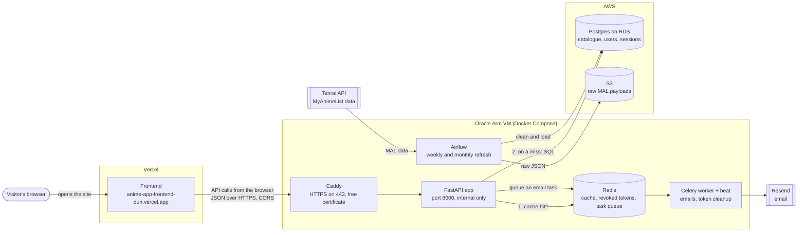
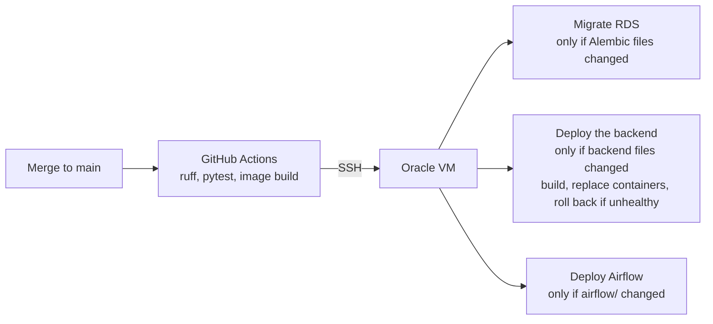

# AnimePlanet backend

An anime analytics API built on MyAnimeList data (about 23,000 anime). It serves search, per-anime statistics and platform-wide rankings, and the data is kept fresh by a scheduled pipeline.

**Frontend:** https://anime-app-frontend-dun.vercel.app

**Live API docs:** https://animeplanet-api.duckdns.org/docs

## What it does
- **Catalogue:** search and filter anime by title, type, status, season, year, tags, studios and score.
- **Per-anime statistics:** score distribution, list status and drop rate, engagement, how it ranks against similar anime, and an episode-by-episode score trend.
- **Platform statistics:** counts and scores by year, type, season, tag and studio, plus lists such as hidden gems and most dropped.
- **Accounts:** sign up, email verification, login with short-lived JWTs and a rotating refresh-token cookie.
- **Data pipeline:** Airflow fetches MAL data (through the Tenrai API) into S3, then cleans it into Postgres on a weekly and monthly schedule.
- **Redis cache:** hot endpoints are cached for an hour (measured in `docs/METRICS.md`: the full request mix at 50 users went from 54 to 154 requests per second).

## Stack
FastAPI, async SQLAlchemy with asyncpg, Postgres (AWS RDS), Redis, Celery, Airflow, Alembic, structlog, uv. Deployed with Docker Compose on an Oracle Arm VM, with Caddy for HTTPS.

## Architecture


- **A request:** the browser calls the API over HTTPS. Caddy passes it to FastAPI, which checks Redis first. On a miss it reads Postgres and caches the answer for an hour.
- **Login:** the access token (30 minutes) comes back in the JSON. The refresh token is an HttpOnly cookie; sessions are stored in Postgres and revoked tokens in Redis.
- **Data in:** Airflow pulls MAL data from the Tenrai API, keeps the raw JSON in S3, then cleans it into Postgres on a weekly and monthly schedule.
- **Email:** the API queues a task in Redis, and the Celery worker sends it through Resend.

## Run it locally
```bash
uv sync --group dev
docker compose up -d db redis
uv run --env-file .env.local alembic upgrade head
uv run --env-file .env.local uvicorn app.main:app --reload    # http://localhost:8000/docs
```
You need an `.env.local` with the settings in `app/config.py` (env files are not in the repo).

```bash
uv run pytest        # no database needed; the real-Postgres tests run when TEST_DB_URL is set
uv run ruff check .
```

## How it is deployed
GitHub Actions runs the tests and the image build on every push. When the backend changes on `main`, it also deploys to the Oracle VM over SSH, with a rollback if the new containers are not healthy. Setup and day-to-day steps are in [`docs/deploy.md`](docs/deploy.md).



## More
- [`CONTEXT.md`](CONTEXT.md): the product vocabulary and vision (an AI "mood search" is planned, not built yet).
- [`docs/adr/`](docs/adr): the design decisions and why.
- [`docs/METRICS.md`](docs/METRICS.md): every measured number (query timings, indexes, load tests).
